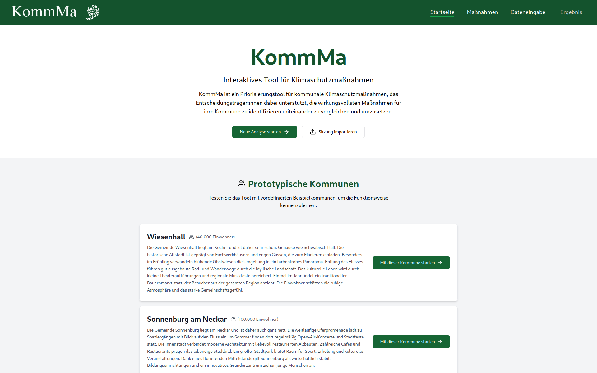
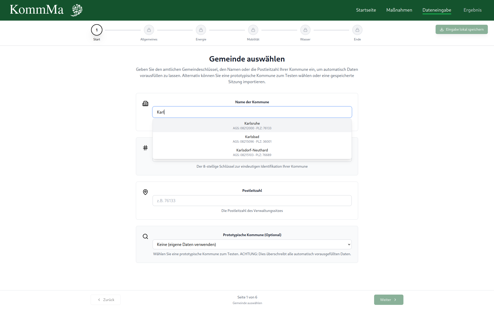
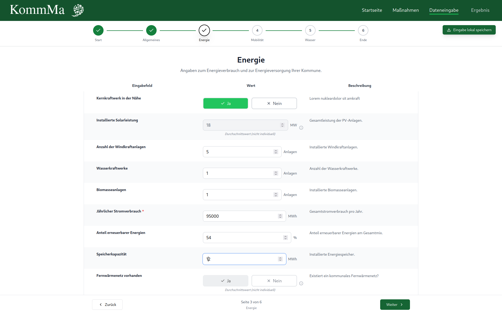
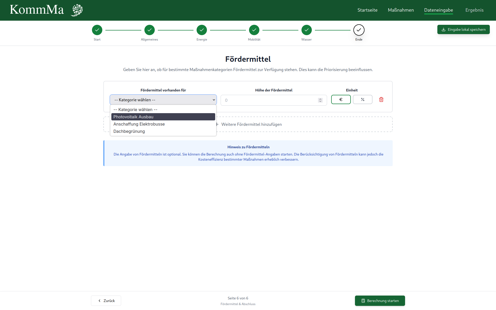
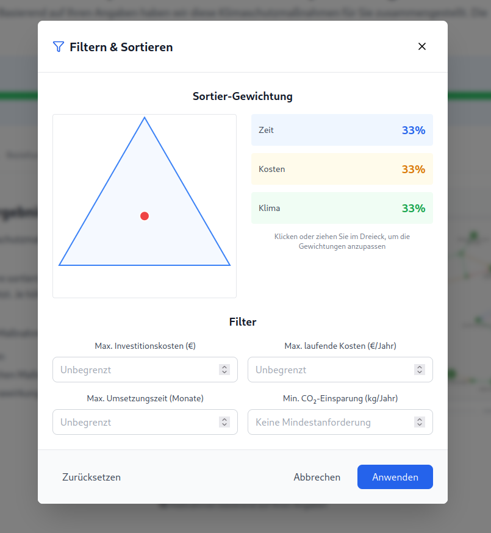
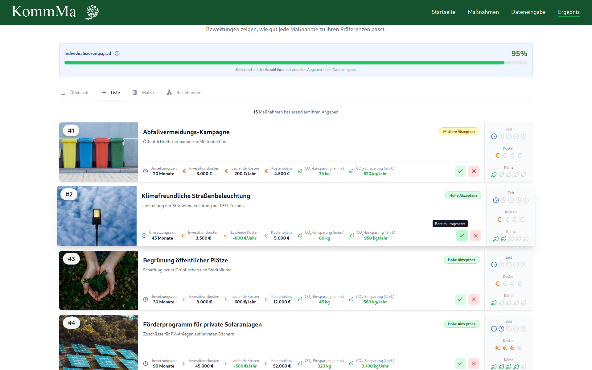
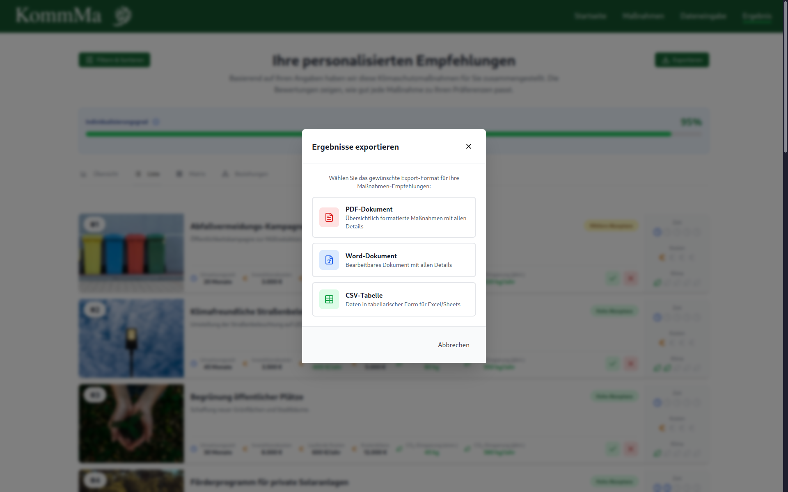

# KommMa – An Interactive Decision-Making-Support Tool for Climate Change Mitigation

## Overview
KommMa is an open-source decision-support tool for municipal climate action planning. The goal is to support municipal to select the best fitting climate change mitigation.
For more information please have a look at [paper.md](paper.md).

## Features
### Guided data entry for a municipality
- Commune search by name, postal code or official municipality key (AGS).
- Automatic prefilling of input fields from public data sources such as Destatis.
- Guided input distributed across four categories (General, Energy, Mobility, Water). Optionally, available subsidies can be declared per measure category.
- Reference communes: predefined example municipalities that let users try out the tool without entering their own data.
- Save and resume: all inputs can be exported as a JSON file and imported later on.
- Data freshness warning if the underlying datasets in the backend are outdated.

### Evaluation and ranking of measures
- Every measure is calculated individually for the commune along three criteria: implementation time, cost (investment, ongoing and total cost) and climate impact (one-time and annual CO₂ savings).
- The criteria are normalised to scores and combined into a total score. Users can adjust the weighting of time, cost and climate impact via an interactive triangle and filter results by maximum investment cost, ongoing cost, implementation time and minimum emission savings.
- The level of individualisation shows, per category and in total, how much of the result is based on commune-specific data rather than averages, so users can judge how reliable the result is.
- Public acceptance (high/medium/low) and an explanation are shown for each measure.

### Interdependencies between measures
Measures are not independent of one another. KommMa models the relationships between measures and takes them into account when presenting results:
- Synergies: two measures reinforce each other (always bidirectional), e.g. their combination increases the overall benefit.
- Contributions: implementing one measure benefits another (one direction only).
- Conflicts: two measures affect each other negatively (always bidirectional), e.g. they compete for the same resources or space.
- Implementation dependencies: a measure requires another measure to be implemented first (prerequisite/dependency).

These relationships are used in several places:
- Users can mark measures as already implemented or infeasible. Remaining measures that benefit from an implemented measure are highlighted in green, measures in conflict with it in red (striped if both apply).
- Marking a measure as infeasible also hides all measures that (transitively) depend on it, after a confirmation that lists how many measures are affected.
- The measure details show which prerequisites have to be implemented first.
- The graph view displays the top-ranked measures as an interactive network: node size reflects the total score, colour-coded edges show synergies, conflicts and contributions. Selecting a measure highlights its direct neighbours.
- Exported reports contain a table of all relationships between the exported measures.

### Result views and export
- Overview with an explanation of the scoring, a preview of the graph and matrix views, and the ranked list.
- List view with detailed measure cards (absolute values and icon scales).
- Matrix view: bubble chart of cost vs. time, where bubble size reflects climate impact, to spot "quick wins" at a glance.
- Graph view of the interdependencies (see above).
- Export of the results as PDF, DOCX or CSV, including the ranking, comments on public acceptance and the relationships between measures.
- Measure catalogue: all measures can be browsed and searched independently of a calculation, including descriptions and links to further information.

### Maintainable data basis
- All calculation logic and measure data are defined in Excel workbooks, so domain experts can adjust or extend measures without changing code.
- External datasets are downloaded and updated automatically (nightly job); a half-yearly check notifies the administrator by email when new source data is available.
- Changes in the master data table are automatically propagated to all dependent measure calculation sheets.

## Requirements
### Software
Git
Docker Engine (Linux) or Docker Desktop (Windows/macOS) 
Docker Compose Plugin

### Hardware 
| Resource | Minimum | Recommended |
|---|---|---|
| CPU | 1 core | 2 cores |
| RAM | 2 GB | 4 GB |
| Storage | 10 GB | 30 GB |

Note: Storage majorly depends on used data (database and pictures)

### Infrastructure [PRODUCTION ONLY]
Server
Domain (currently "kommma.com")
Cloudflare Tunnel Token (matching the Domain)
### Infrastructure [DEVELOPMENT ONLY]
Open ports: 3000 (Frontend), 8000 (Backend), 4000 (Stub)

## Installation
0. Make sure that all requirements are met. (see [Requirements](#requirements)).
1. Clone git repository.
2. Add data, secrets and configure (see [Configuration](#configuration)).
3. Install daemons for external API integration (follow the installation guides provided by [README_DAEMON_JOB](backend/services/README_DAEMON_JOB.md), [README_EXCEL_SYNC_DBRL](backend/services/README_EXCEL_SYNC_DBRL.md), [README_HALFYEAR_DAEMON](backend/services/README_HALFYEAR_DAEMON.md)).
4. Run "cd infra && docker compose up -d --build".

## Configuration
1. Add your usage data in "data/".
2. Add "login_data.env" by altering "example.login_data.env" and configure the required email and database login credentials inside the file.
3. Add "infra/.env" by altering "infra/example.env" and configure like described in the file.
   There you can choose between development and production mode!
   If you use production mode, make sure to add your Cloudflare tunnel token!
### PRODUCTION ONLY
4. Replace all occurences of "kommma.com" in "infra/nginx/nginx.conf" with your own domain.
5. Replace all legal information (especially [LegalDisclosurePage](frontend/webapp/src/pages/LegalDisclosurePage.tsx), [PrivacyPolicyPage](frontend/webapp/src/pages/PrivacyPolicyPage.tsx), [Footer](frontend/webapp/src/layout/Footer.tsx)) with your own.
6. [optional] Add login credentials:
   - a) Run "sudo apt install apache2-utils && htpasswd -c infra/nginx/.htpasswd <username>". You will be asked to type in a password.
   - b) [optional] Add a file (e.g. infra/nginx/login) with your credentials (potential security risk!).
   - c) Uncomment both lines in "infra/nginx/auth.conf".

### Secrets
- data/
- login_data.env
- infra/.env
- infra/nginx/.htpasswd

## Basic Usage
After starting the containers, open the frontend in your browser (`http://localhost:3000` for local development, or your configured domain in production). Make sure, that the file frontend/webapp/config.tsx has the correct constant set, to match your backend of choice. The user interface is in German; the original button labels are given in *italics* below.

The navigation bar at the top links to the start page (*Startseite*), the measure catalogue (*Maßnahmen*), data entry (*Dateneingabe*) and the results (*Ergebnis*). The results page becomes available once a calculation has been run.

### 1. Start page


You have three options upon start:
- Start a new analysis (*Neue Analyse starten*) to enter data for your own municipality.
- Import a session (*Sitzung importieren*) to continue from a previously saved JSON file. Imported values are checked against the current data basis and updated where newer data is available.
- Try a reference commune by clicking one of the example municipalities. This loads a complete set of inputs, so you can explore the tool without entering your own data.

Here, the user is also informed in case there is any outdated data used in the backend.

### 2. Selecting a municipality


Look up your municipality by name (with autocomplete), by its 8-digit official municipality key (AGS) or by postal code. Once a municipality is selected, the input fields are prefilled automatically from public data sources. You can also select a reference commune here as a starting point instead.

### 3. Enter your data


The inputs are divided into four categories: General (*Allgemeine Angaben*), Energy (*Energie*), Mobility (*Mobilität*) and Water (*Wasser*). Use *Weiter* and *Zurück* to move between them. The progress bar shows your current step.

- Each field has a description on the right. The source of a prefilled value is shown in a tooltip next to the field.
- Values marked as *Durchschnittswert (nicht individuell)* are averages rather than commune-specific data. Replace them with your own values wherever possible to make the results more reliable.
- Required fields are marked with a red star (\*). You cannot continue until they are filled in.
- Click Save input locally (*Eingabe lokal speichern*) at any time to download your inputs as a JSON file. You can import it later from the start page.

### 4. Subsidies and calculation


In the last step (*Fördermittel & Abschluss*) you can optionally declare available subsidies for each measure category, either as an absolute amount (in Euro) or as a percentage. Then click *Berechnung starten* to run the calculation.

### 5. Explore the results


The results page ranks all measures by their total score. The individualisation bar at the top shows how much of the result is based on your commune-specific data. Four tabs offer different views:
- Overview (*Übersicht*): an explanation of the scoring, previews of the other views and the top-ranked measures.
- List (*Liste*): detailed cards for every measure with costs, time, CO~2~ savings and public acceptance.
- Matrix: a bubble chart of cost vs. time, where bubble size reflects climate impact.
- Relationships (*Beziehungen*): an interactive graph of synergies, conflicts and contributions between the top measures.



Click Filter & Sort (*Filtern & Sortieren*) to adjust how time, cost and climate impact are weighted in the ranking, or to filter measures by maximum cost, maximum implementation time or minimum emission savings.



On each measure card you can mark a measure as already implemented (*Bereits umgesetzt*) or infeasible (*Nicht umsetzbar*). Related measures are then highlighted: green for measures that benefit from it, red for conflicts. Marking a measure as infeasible also hides measures that depend on it, after you confirm. Marked measures can be unmarked at any time.

### 6. Export


Click Export (*Exportieren*) to download the results as a PDF report, an editable Word document or a CSV table. Only the measures currently visible are exported, so filtered-out or marked measures are left out. The PDF and Word reports also include a table of the relationships between the exported measures.

## Project Structure
KommMa has a Python Backend and a Rust Frontend. The tree below shows the important structure of the project:
```bash
KommMa/
├── backend/
│   ├── Dockerfile
│   ├── requirements.txt                         # Python dependencies
│   ├── services/                                # systemd services and timers
│   ├── test/                                    # Backend tests
│   └── src/
│       ├── ApplicationLayer/                    # Application logic and API
│       │   ├── api/
│       │   ├── CalculationApi/
│       │   ├── DataApi/
│       │   └── Validation/
│       ├── app_logging/                         # Application logging
│       ├── config.py                            # Backend configuration
│       ├── DatabaseRepositoryLayer/             # Excel-backed data access and calculations
│       │   ├── CalculationRepository/
│       │   │   ├── engine/
│       │   │   │   └── formulaEngine.py
│       │   │   └── preprocessing/
│       │   ├── DataInputRepository/
│       │   ├── ExcelSyncRepository/
│       │   ├── GraphRepository/
│       │   ├── MeasureRepository/
│       │   └── ReferenceCommuneRepository/
│       ├── dependencies/                        # Dependency injection and service wiring
│       ├── EMail_Service.py                     # Automated administrator emails
│       ├── Exceptions/                          # Custom exceptions
│       ├── externalAPI/                         # External data integration
│       │   ├── Checker.py                       # Source freshness checks
│       │   ├── DaemonJob.py                     # Nightly data download and update job
│       │   ├── Downloader.py                    # External data downloads
│       │   ├── HalfyearJob.py                   # Semiannual source update checks
│       │   ├── Parser.py                        # Municipal data lookup, prefilling and validation
│       │   └── Updater.py                       # Local dataset updates
│       └── main.py                              # Backend entry point
├── config/                                      # Configuration files
│   ├── Checker.json                             # Source update checks and last-seen metadata
│   ├── constants_that_change.json               # Last notification dates and dataset reference year
│   ├── DownloadConfig.json                      # External data source settings
│   ├── ExcelSyncConfig.json                     # Automatic Excel synchronization
│   └── Input_fields_id.json                     # Input field identifier mappings
├── data/                                        # Data directory for Excel models, external datasets, and images
├── frontend/
│   ├── Dockerfile
│   ├── stub_backend/                            # Mock backend for frontend testing
│   └── webapp/
│       ├── package.json                         # Dependencies and build scripts
│       ├── public/                              # Static assets
│       └── src/
│           ├── App.tsx
│           ├── components/                      # Reusable UI components
│           │   ├── input/
│           │   │   └── fields/
│           │   ├── measures/
│           │   ├── ReferenceCommuneCard.tsx
│           │   └── results/
│           ├── config.tsx
│           ├── index.tsx
│           ├── layout/                          # Page layouts
│           ├── pages/                           # Application pages
│           ├── routing/                         # Route guards
│           ├── services/                        # API clients and import/export services
│           ├── store/                           # Redux state management
│           ├── types/                           # Type definitions
│           └── utils/                           # Utility functions
└── infra/                                       # Deployment infrastructure
    ├── docker-compose.yml
    └── nginx/                                   # Reverse proxy and optional access control
```
The frontend tests are located in `*.test` directories alongside the corresponding source directories in `frontend/webapp/src/`.


## Further Information
- [Website: www.kommma-im-klimaschutz.de/index.php](https://www.kommma-im-klimaschutz.de/index.php) 
- [JOSS Paper](paper.md)
